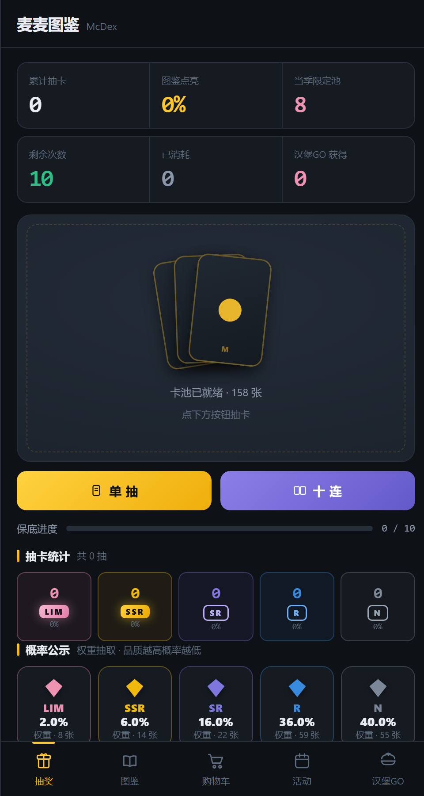
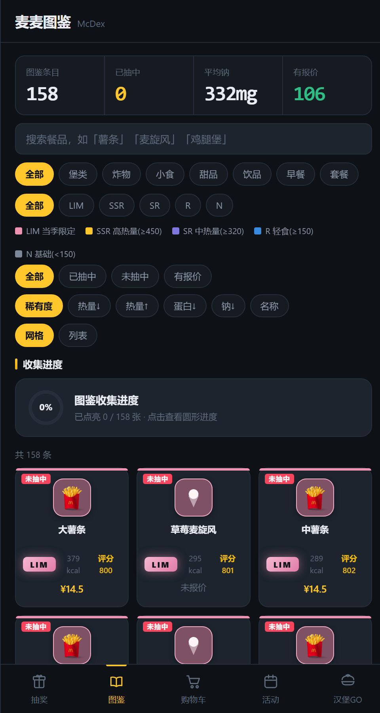

# 麦麦图鉴 · McDex

> WorkBuddy和麦当劳开发大赛参赛项目
> 比赛官方仓库为https://github.com/M-China/mcd-mcp-server

> 把麦当劳中国的餐品数据整理成一份**可以抽、可以翻、有收集进度**的图鉴。  
> 纯前端 · 单文件 · 只读 · 零后端 —— 双击 `index.html` 就能跑。

<p align="center">  
    
    
    
    
</p>

---

## 这是什么

一个把「今天吃什么」变成抽卡游戏的小工具。数据全部来自麦当劳中国官方 MCP  
（`mcp.mcd.cn`，共 35 个工具），**没有爬虫、没有第三方接口、没有写操作**。

| 页签       | 回答的问题       | 本质           |
| -------- | ----------- | ------------ |
| **抽奖**   | 今天吃哪个？      | 决策辅助         |
| **图鉴**   | 这东西什么来头？    | 资料查询         |
| **购物车**  | 这顿多少钱、多少热量？ | 组合试算         |
| **活动**   | 最近有什么限定？    | 信息聚合         |
| **汉堡GO** | ——          | 跳一跳小游戏，赢抽奖次数 |

**刻意不做**：不诱导消费、不做自动下单、不做排行榜与社交比较、不碰积分抽奖接口。  
产品的胜利条件是「帮你更快决定吃什么」，不是「让你多吃」。

---

## 功能一览

### 🎴 抽奖

- 单抽 / 十连，卡池为全部 158 张餐品卡
- **稀有度由数据算出，无隐藏权重**：限定 → 高热量 → 低热量共 5 档
- **两重保底**：十连内无 SR+ 则第 10 张强制替换；累计 10 抽无 SR+ 则下一抽强制从 SR+ 池抽（进度条可见）
- **抽奖次数与游戏挂钩**：初始 10 次，每次消耗记入「已消耗」，「汉堡GO」每 10 格兑换 1 次
- 概率公示、抽卡记录（最近 24 抽）、限定卡池出货闪光

### 📖 图鉴

- 158 条真实营养数据，网格 / 列表双视图
- 三重筛选：属性（7 类）× 稀有度（5 档）× 点亮状态
- 五种排序：稀有度 / 热量↓↑ / 蛋白↓ / 钠↓ / 名称
- **详情弹层**：六大营养素条形图 + 占每日参考值（NRV）百分比
- 收集进度环，点击可看分类进度

### 🛒 购物车

- 勾选餐品实时合计金额与总热量
- 「随机搭配一套」：按当前勾选项生成整套组合
- 搭配建议：基于钠 / 热量 / 蛋白的结构化提示

### 📅 活动

- 12 条真实活动日历，按「离今天远 → 近」排序
- 标记「新品」「限定」的活动会自动进入当季限定卡池
- 点击可跳转官方素材页

### 🍔 汉堡GO（跳一跳）

- 按住蓄力、松手起跳，抛物线指示线 + 落点目标环
- 60 秒限时，踩中下一张食材台得 1 格，每 10 格结算 1 次抽奖机会
- 全 Canvas 手绘：视差云、漂浮亮片、6 种食材台、带表情的汉堡角色
- 待机浮动 / 蓄力眯眼 / 失败 X 眼翻滚坠落，独立开始界面与结算界面

---

## 快速开始

```bash
git clone https://github.com/<your-name>/mBook.git
cd mBook
```

**方式一：直接打开**（最快）

双击 `index.html`，或者拖进浏览器。

**方式二：起个本地服务**（推荐，`file://` 下部分浏览器会限制 `localStorage`）

```bash
python -m http.server 8080
# 打开 http://localhost:8080
```

**方式三：部署到 GitHub Pages**

仓库 Settings → Pages → Source 选 `main` 分支 `/ (root)` → 保存，  
之后访问 `https://<your-name>.github.io/mBook/`。

> 无需 `npm install`、无需构建。整个应用就是一个 HTML 文件。

---

## 项目结构

```
mBook/
├── index.html              # 全部实现：样式 + 数据 + 逻辑（单文件，可直接打开）
├── README.md
├── LICENSE                 # MIT
├── .nojekyll               # GitHub Pages 不做 Jekyll 处理
├── data/
│   ├── mcd-data.js         # 数据层的独立副本（index.html 内联了同一份）
│   └── mcd-mcp-tools.json  # 官方 MCP 的 35 个工具清单原始快照（数据溯源）
├── docs/
│   ├── 数据说明.md          # 数据来源、字段格式、如何刷新
│   ├── 开发笔记.md          # 实现要点与踩过的坑
│   └── 产品方案.md          # 早期产品方案（v3，保留作背景）
└── screenshots/            # README 用截图
```

**关于「单文件」**：`index.html` 把 CSS、数据、逻辑全部内联，目的是让它能脱离任何  
构建环境和网络依赖直接运行。`data/mcd-data.js` 是同一份数据的独立副本，便于做数据  
处理或整体替换；**修改它不会自动生效**，需要同步替换 `index.html` 里对应的  
`<script>` 数据块（见 `docs/数据说明.md`）。

---

## 数据来源

数据来自麦当劳中国官方 MCP 服务 `https://mcp.mcd.cn`（2026-10-10 快照）：

| 内联变量            | 来源工具                   | 内容                | 规模    |
| --------------- | ---------------------- | ----------------- | ----- |
| `MCD_NUTRI_RAW` | `list-nutrition-foods` | 餐品 + 能量描述 + 六大营养素 | 158 条 |
| `MCD_CAMPAIGNS` | `campaign-calendar`    | 当月活动日历            | 12 条  |
| `MCD_PRICES`    | `query-meals`          | 门店参考单价            | 121 条 |
| `MCD_CAMP_URL`  | `campaign-calendar`    | 活动官方素材链接          | 12 条  |
| `MCD_IMAGES`    | `query-meals`          | 商品图（官方 CDN）       | 45 张  |

`MCD_NUTRI_RAW` 行格式（`|` 分隔）：

```
名称|能量描述|kcal|蛋白质g|脂肪g|碳水g|钠mg|钙mg
```

**价格匹配率约 67%**（106 / 158）。未匹配的主要是早餐与部分季节限定商品，它们不在  
全天菜单里，因此接口没有报价；页面上显示为「未报价」，不影响其他功能。

> token 不写入仓库、不写入前端。刷新数据请在本地 MCP 客户端里拉取后手动替换，  
> 具体步骤见 `docs/数据说明.md`。

---

## 稀有度规则

稀有度**完全由数据算出**，没有隐藏权重表：

| 稀有度        | 判定条件               | 数量 | 抽取权重 |
| ---------- | ------------------ | -- | ---- |
| `LIM` 当季限定 | 商品名命中当月活动文本中的限定关键词 | 8  | 2    |
| `SSR` 高热量  | 能量 ≥ 450 kcal      | 14 | 6    |
| `SR` 中热量   | 320 – 449 kcal     | 22 | 16   |
| `R` 轻食     | 150 – 319 kcal     | 59 | 36   |
| `N` 基础     | < 150 kcal（多为饮品小食） | 55 | 40   |

「限定」判定是动态的：每月活动日历变化后，命中关键词的商品会自动变成 `LIM`，  
不需要人工维护名单。

---

## 技术要点

- **纯原生**：无框架、无依赖、无构建，一个 HTML 文件即全部
- **容错存储**：`localStorage` 全部包在 `try/catch` 里，沙箱 / 预览环境抛异常时自动  
  退回内存存储（早期踩过「所有按钮点不动」的坑，根因就在这里）
- **事件委托**：统一 `addEventListener`，不使用内联 `onclick`
- **Canvas 小游戏**：`requestAnimationFrame` 主循环 + `dt` 时间步进，抛物线用真实  
  弹道公式采样；失败动画用手写重力积分
- **响应式**：单屏 App Shell（`main{flex:1;min-height:0}`），移动端优先，弹框全屏居中
- **图标兜底**：官方商品图加载失败时，底下的手绘 SVG 会露出来

更多实现细节与踩坑记录见 [`docs/开发笔记.md`](docs/开发笔记.md)。

---

## 已知限制

- 数据是 **2026-10-10 的快照**，不是实时数据；新品上架需要手动刷新
- 价格是**门店参考价**，与实际到手价（含优惠）会有差异
- 微信内置浏览器打开本地 `file://` HTML 时可能不执行 JS，请用系统浏览器或本地服务
- 汉堡GO 目前是单人本地玩法，没有排行榜与音效

---

## 免责声明

- 本项目是**非官方的个人练习项目**，与麦当劳中国及其关联公司**无任何关系**，  
  未获得其授权、赞助或认可。
- 所有餐品名称、营养数据、价格、图片、活动信息均来自麦当劳中国官方 MCP 接口的  
  公开返回结果，**版权归原权利方所有**，本项目仅作学习与研究用途，不作商业用途。
- 数据仅供参考，**不能作为营养摄入、医疗或消费决策的依据**；请以门店实际信息为准。
- `McDonald's`、`麦当劳`、`McDex` 之外的商标（如 PEACEMINUSONE 等）均为其各自  
  所有者的财产，仅出现在活动日历的原始文本中。
- 本项目**不调用任何写接口**，不会下单、不会消耗积分、不会修改任何账户状态。
---

## License

[MIT](LICENSE)
